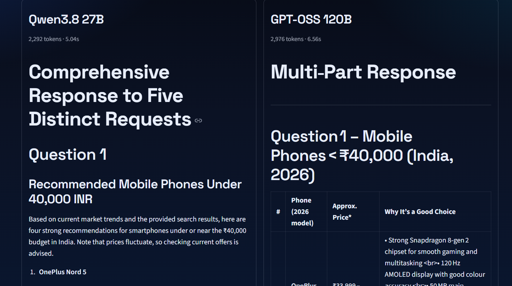
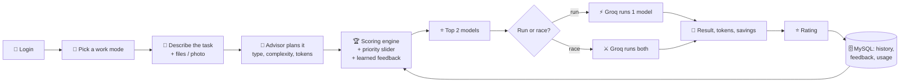
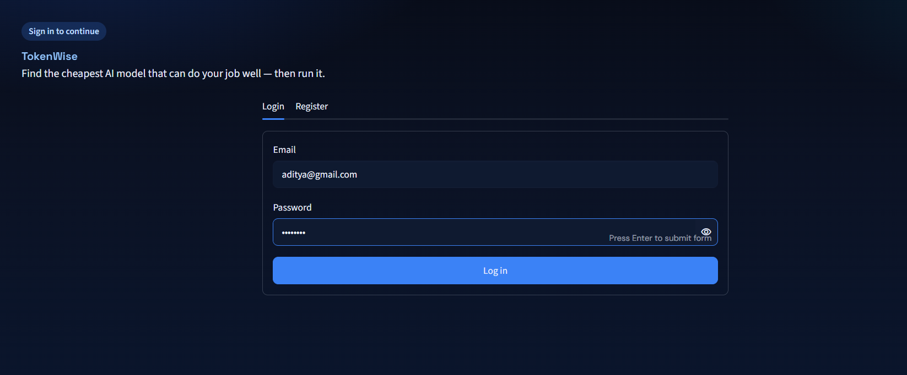
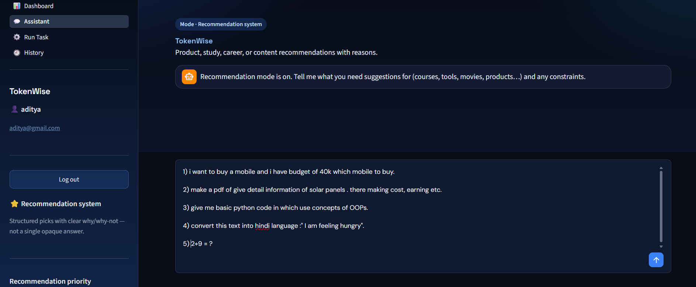
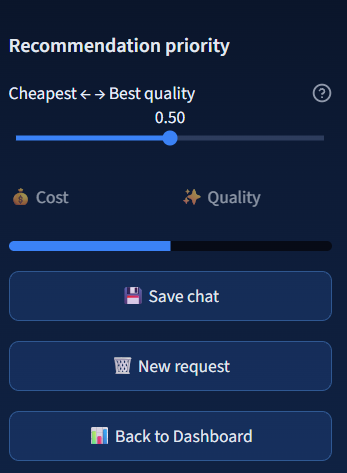
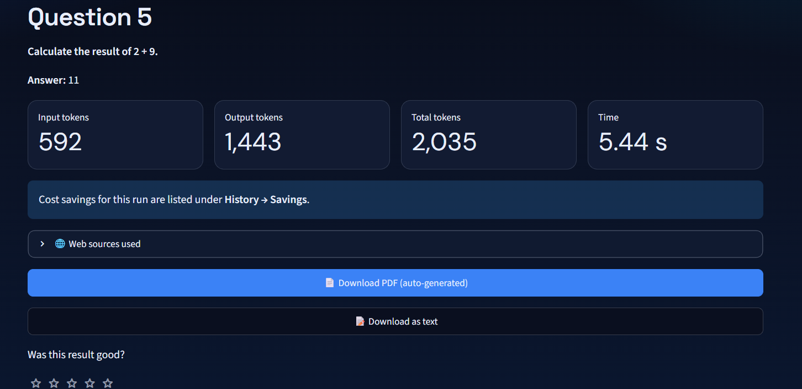
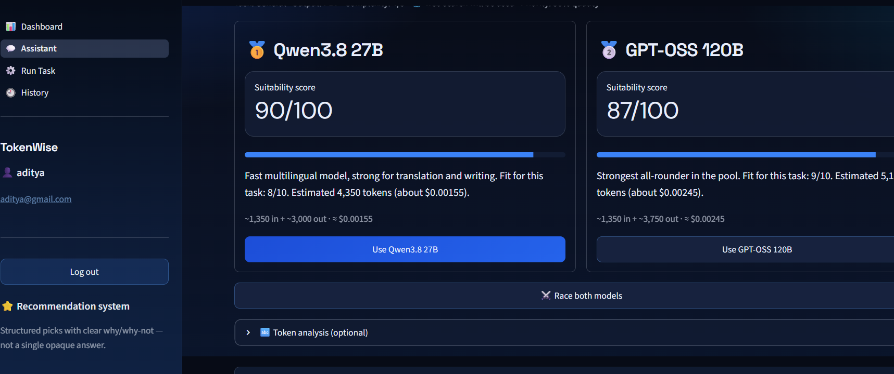
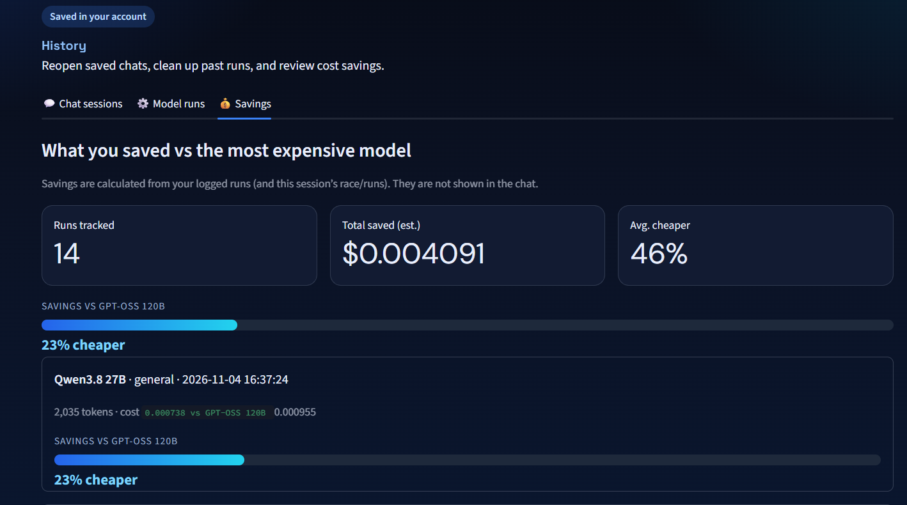
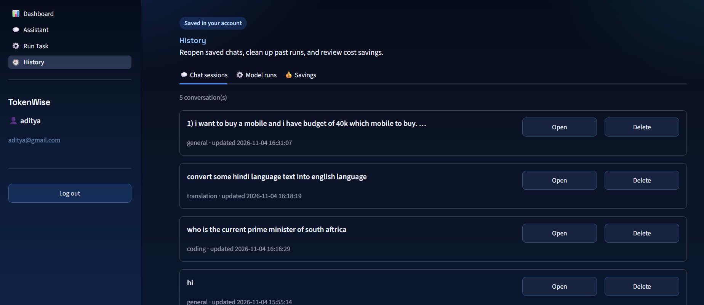
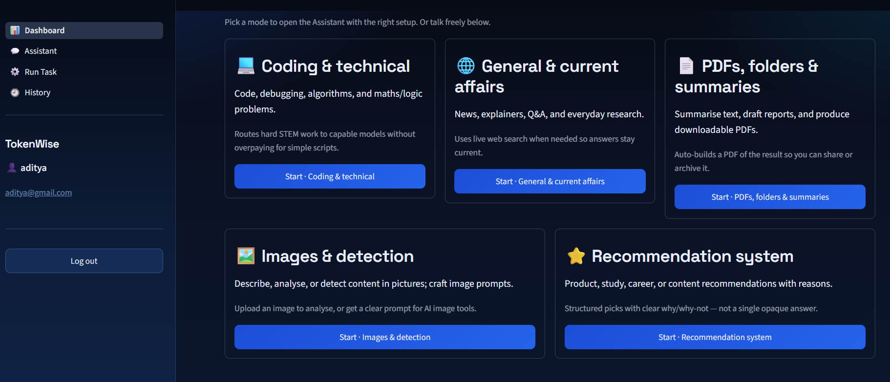

<div align="center">

# 🤖 TokenWise

### Don't pick an AI model. Describe the job, and TokenWise picks the cheapest one that can do it well, then runs it.


[Demo video](#-demo-video) · [Features](#-features) · [How it works](#-how-it-works) · [Screenshots](#-screenshots) · [Setup](#-setup) · [Roadmap](#-roadmap)



</div>

---

## 💡 The problem

Many AI models exist, and most people can't tell which one is cheap *and* good enough for their job.
Using a huge model for a simple task wastes tokens, money and time. Most tools only recommend a
model. TokenWise recommends, runs it, proves the saving, and learns from your feedback.

## 🎬 Demo video

> 📺 **[Watch the 120-second demo](

https://github.com/user-attachments/assets/904208ac-6c29-4cef-81ee-628413348b7d


)**

## ✨ Features

| | Feature | What it does |
|---|---|---|
| 🧠 | **Smart task planning** | An advisor reads your request and returns task type, complexity, estimated tokens and whether live data is needed |
| 🏆 | **Top-2 recommendation** | Ranks models on quality fit, cost and token efficiency |
| ⚖️ | **Priority slider** | Slide between *cheapest* and *best quality* and the ranking changes instantly, with no extra AI call |
| ⚔️ | **Race mode** | Runs both models side by side and compares output, tokens, time and cost |
| 💰 | **Savings meter** | Shows how much cheaper your pick was than the most expensive model |
| ⭐ | **Feedback learning** | Star ratings adjust future rankings once a model has enough votes |
| 🌐 | **Live web search** | SerpAPI adds up-to-date facts when the task needs them |
| 📎 | **Files, photos and camera** | Upload txt, md, csv, pdf, docx or images, or take a photo, with OCR and image analysis |
| 📄 | **PDF export** | Results download as a PDF |
| 🕘 | **Chat history** | Chats are saved, can be reopened later and can be deleted |
| 📊 | **Dashboard** | Runs, tokens and model mix over time |
| 🔐 | **Secure accounts** | bcrypt-hashed passwords in MySQL, parameterised SQL, keys in `.env` |

### 🧭 Five work modes

| Mode | Use it for |
|---|---|
| 💻 Coding & technical | Code, debugging, algorithms, maths and logic |
| 🌐 General & current affairs | News, explainers and Q&A with live web search |
| 📄 PDFs, folders & summaries | Summaries and reports, auto-exported as PDF |
| 🖼️ Images & detection | Describe or analyse an uploaded picture, or write a strong prompt for an AI image tool |
| ⭐ Recommendation system | Structured picks with reasons for products, courses, tools and more |

## 🔄 How it works



### Scoring

| Factor | Default weight |
|---|---|
| Quality fit for the task type | 50% |
| Cost efficiency | 30% |
| Token efficiency | 20% |

The priority slider shifts these weights. Hard tasks (complexity 4 to 5) are only offered to models rated 8/10 or higher.
Quality ratings are hand-set estimates in `core/model_registry.py`. User star ratings nudge them once a model has enough votes.

## 🖼️ Screenshots

| Login | Assistant | Recommendations |
|---|---|---|
|  |  |  |

| Priority slider | Result and savings | Race mode |
|---|---|---|
|  |  |  |

| saving | History | Dashboard |
|---|---|---|
|  |  |  |

## 🧰 Tech stack

| Layer | Tools |
|---|---|
| Interface | Streamlit |
| Planner / advisor | Groq (fast path) with Gemini fallback and a built-in heuristic backup |
| Model execution | Groq API |
| Vision / OCR | Groq vision model with Gemini fallback |
| Web search | SerpAPI |
| Database | MySQL, mysql-connector-python |
| Security | bcrypt, parameterised SQL, `.env` secrets |
| Documents | ReportLab, pypdf, Pillow |
| Tokenization | Hugging Face Transformers |
| Testing | pytest |

## 📁 Project structure

```
tokenwise/
├── app.py                 # entry point: login gate + navigation
├── pages/
│   ├── login_register.py
│   ├── dashboard.py       # work-mode hub + usage charts
│   ├── assistant.py       # chat, uploads, camera, top-2 recommendations
│   ├── run_task.py        # run / race, savings meter, ratings
│   └── history.py         # saved chats: open / delete
├── core/
│   ├── advisor.py         # task planner (Groq -> Gemini -> heuristic)
│   ├── scoring.py         # ranking engine, priority, feedback, savings
│   ├── model_registry.py  # models, prices, quality ratings
│   ├── runner.py          # Groq execution
│   ├── media.py           # files, images, OCR
│   ├── work_modes.py      # the five work modes
│   ├── pdf_builder.py     # text -> PDF
│   └── tokenizer.py       # token analysis
├── db/                    # connection pool, schema, migrations, users, history
├── ui/theme.py            # custom styling
├── tests/test_scoring.py
├── docs/                  # DEMO.md and screenshots
└── web_search.py          # SerpAPI wrapper
```

## 🚀 Setup

**1. Clone and install**
```bash
git clone https://github.com/adityagautam9321-sudo/tokenwise.git
cd tokenwise
python -m venv .venv
.venv\Scripts\activate          # Windows  (Mac/Linux: source .venv/bin/activate)
pip install -r requirements.txt
```

**2. Create the database**
Run `db/schema.sql` in MySQL Workbench. The app also creates any missing tables on start.

**3. Add your keys**
Copy `.env.example` to `.env` and fill it in:

| Variable | Where to get it |
|---|---|
| `GEMINI_API_KEY` | [Google AI Studio](https://aistudio.google.com) |
| `GROQ_API_KEY` | [Groq Console](https://console.groq.com) |
| `SERPAPI_KEY` | [SerpAPI](https://serpapi.com) |
| `MYSQL_*` | Your local MySQL settings |

**4. Run**
```bash
streamlit run app.py
```

**5. Test**
```bash
python -m pytest tests/ -q
```

## 🗺️ Roadmap

- [x] Task planning, top-2 ranking and execution
- [x] Login, history, dashboard
- [x] Priority slider, race mode, savings meter
- [x] Feedback learning
- [x] File, photo and camera input
- [x] Five work modes
- [ ] Multi-step problems, each step on the cheapest capable model
- [ ] More model providers
- [ ] Unicode fonts for non-Latin PDFs
- [ ] Per-user monthly budget

## ⚠️ Limitations

- Prices and quality ratings are estimates, not benchmark results.
- The image mode analyses pictures and writes image prompts. It does not generate images.
- PDFs use built-in fonts, so non-Latin scripts are not supported yet.
- Available models depend on what Groq currently serves.

## 👤 Author

Built by **[Aditya](https://github.com/adityagautam9321-sudo)**.

---

<div align="center">⭐ If you find this useful, give the repo a star.</div>
